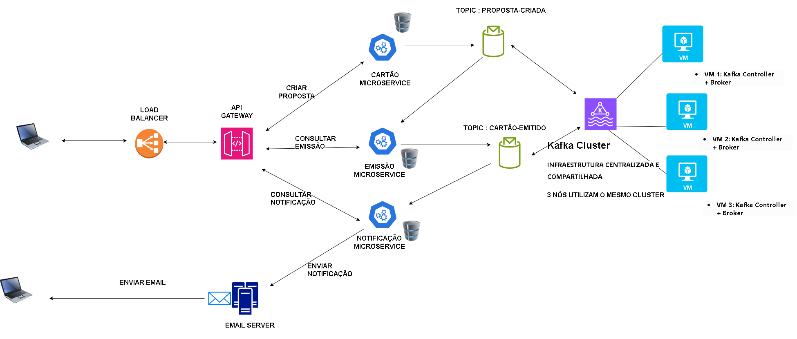

# Sistema de Emissão de Cartões de Crédito com Arquitetura Baseada em Microservices

Sistema backend distribuído que simula o fluxo de análise de crédito e emissão de cartões, utilizando arquitetura orientada a eventos com Apache Kafka e Spring Boot.

O sistema modela o processo de um banco desde o cadastro do cliente até a emissão do cartão.

---

## Problema

Processos de emissão de cartão de crédito em sistemas bancários tradicionais costumam ser:
- Fortemente acoplados
- Difíceis de escalar
- Dependentes de fluxos síncronos
- Pouco resilientes a falhas

Isso dificulta a evolução do sistema e a integração entre etapas como análise de crédito e emissão de cartão.

---

## Solução

Este projeto implementa uma arquitetura baseada em microservices e comunicação assíncrona para simular o fluxo de emissão de cartão.
O sistema é dividido em serviços independentes que se comunicam via eventos.

---

## Stack

- Java 21
- Maven
- Spring Boot
- Apache Kafka
- Docker
- Terraform
- Postgres
- OpenTelemetry

---


## Funcionalidades

- Cadastro de clientes e propostas de crédito (`cartoes-ms`)
- Processamento e emissão de cartões (`emissor-ms`)
- Comunicação assíncrona entre microservices via Apache Kafka
- Notificação de emissão de cartões por e-mail (`notificacao-ms`)
- Arquitetura desacoplada e orientada a eventos (Event-Driven Architecture)


---


## Responsabilidade de cada serviço

- cartoes-ms: Cadastra o cliente, recebe a proposta inicial e publica o evento no tópico `proposta-criada`.
- emissor-ms: Consome a proposta do tópico `proposta-criada`, simula a análise/emissão do cartão e publica o evento no tópico `cartao-emitido`.
- notificacao-ms: Consome o evento do tópico `cartao-emitido` e simula o envio de e-mail ao cliente.


---


## Como executar: 


### 1. Provisionamento da Infraestrutura com Terraform
Acesse o diretório de infraestrutura e execute:

```bash
terraform init
terraform validate
terraform plan
terraform apply
```

### 2. Inicialização dos Bancos de Dados
Em cada microservice, acesse seu respectivo diretório e execute:
```bash
docker compose up -d
```

### 3. Build dos Microservices
Execute o build dos serviços na seguinte ordem:

1. **cartoes-ms**
2. **emissor-ms**
3. **notificacao-ms**

Em cada diretório, execute:

```bash
 mvn clean install
```

### 4. Inicialização dos Microservices
Inicie os serviços na seguinte ordem:

1. **cartoes-ms**
2. **emissor-ms**
3. **notificacao-ms**

Em cada diretório, execute:


```bash
mvn spring-boot:run

```

---


##### Tópicos Kafka

- `proposta-criada`: Recebe eventos de propostas de emissão de cartões publicados pelo cartoes-ms.
- `cartao-emitido`: Comunica a conclusão da emissão do cartão pelo emissor-ms.
- `proposta-criada-dead-letter`: Armazena mensagens que falharam no processamento pelo emissor-ms, após esgotar as tentativas de retry.
- `cartao-emitido-dead-letter`: Armazena mensagens que falharam no processamento pelo notificatao-ms, após esgotar as tentativas de retry.

---


##### Consumer Groups

- `emissor-group` (`emissor-ms`): Consome proposta e realiza a emissão dos cartões.
- `notificacao-group` (`notificacao-ms`): Consome eventos de emissão e envia notificações por e-mail.

---


##### Estratégia de Resiliência: Dead Letter Topic

 - Política de Retry: O consumidor realizará até 3 tentativas de processamento em caso de falhas.
 - Encaminhamento para DLT: Após esgotar as tentativas, a mensagem é encaminhada para o tópico de falha correspondente.
 - Falha na Emissão (`emissor-ms`): Encaminhada para `proposta-criada-dead-letter` .
 - Falha na Notificação (`notificacao-ms`): Encaminhada para `cartao-emitido-dead-letter`.

---


##### Estratégias de Resiliência e Consistência: Outbox Pattern.

- Transactional Outbox: 
Utilizado para garantir consistência entre a persistência dos dados no banco relacional e a publicação de eventos no Kafka.

- cartoes-ms: salva a proposta e o evento na Outbox.
- emissor-ms: consome o evento proposta , processa a emissão e salva o cartão e o evento na Outbox.
- notificacao-ms: consome o evento, registra a notificação na Outbox e realiza o envio do e-mail.

Um processo em segundo plano publica os eventos pendentes da Outbox no Kafka, reduzindo o risco de inconsistência entre banco de dados e mensageria.


---

## Arquitetura e Decisões Técnicas

- Apache Kafka para comunicação assíncrona entre microservices.
- Um tópico para cada evento de negócio.
- Um consumer group independente por serviço consumidor.
- Retry + Dead Letter Topic (DLT) para tratamento de falhas.
- `pedidoId` como chave das mensagens para garantir ordenação por pedido.
- Idempotência para evitar processamento e emissão duplicados.
- Transactional Outbox Garantia de Entrega com Transactional Outbox


---


### Fluxo da Arquitetura



---

### Infraestrutura: 
explicar os três nós do cluster Kafka provisionados com Terraform. --- DOING

---

### Observabilidade: 
demonstrar como o OpenTelemetry é utilizado. --- DOING

---

### Testes: 
apresentar testes unitários e de integração, se implementados. --- DOING


---


